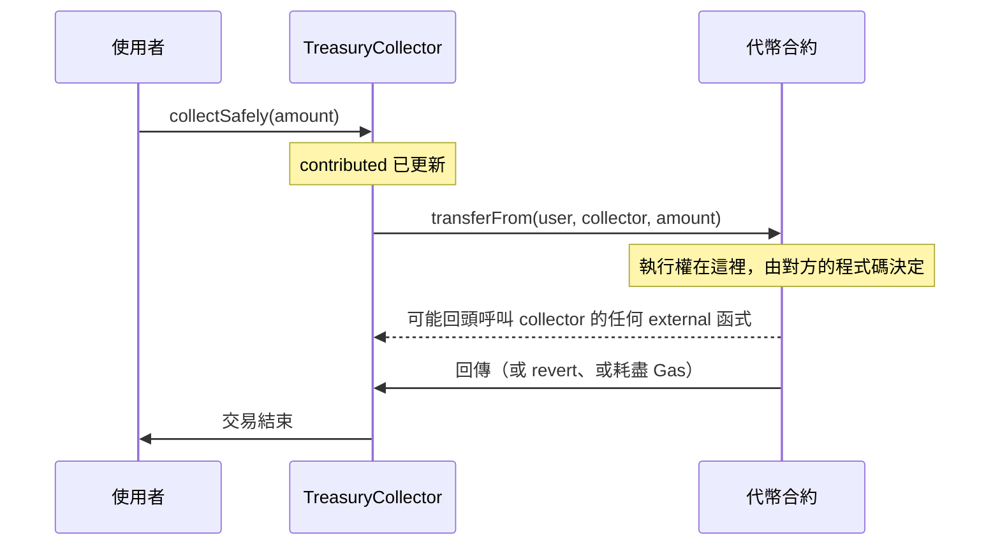

昨天第 3 節的測試用 `try`／`catch` 接住了帳本合約的 revert data，當時留了一句「`try`／`catch` 只能用在外部呼叫上」。這句話背後有一條 Web2 不太需要在意的界線：同一個合約裡的函式呼叫，和呼叫另一個合約，在 EVM 裡是兩種完全不同的動作。今天就沿著這條界線，先看四種可視度各自畫出了什麼邊界，再看合約之間怎麼透過 `interface` 互相呼叫，以及這樣做要付出什麼代價。

先收掉昨天的練習與思考題。

練習二的 `readAt` 越界時是 `Panic(0x32)`，`vm.expectRevert(stdError.indexOOBError)` 就能斷言。練習三的關鍵是讓「總和不可能溢位」變成一個在函式開頭就檢查過的條件，例如限制 `values.length <= 2**32` 且每個元素都小於 `2**224`，總和最多是 2^32 × (2^224 − 1)，一定小於 2^256。但檢查每個元素的大小，本身就是迴圈裡的一次比較，和 checked 加法原本要做的溢位檢查是同一個量級，所以這個例子比較像是練習「怎麼證明 `unchecked` 安全」，而不是一個值得採用的優化。

思考題問的是：假設子合約能直接寫 `_balances[to] += amount`，`ERC20._update` 的哪一個 `unchecked` 會最先出問題。答案是銷毀那一段的 `_totalSupply -= value`。它的證明是「`value <= fromBalance <= totalSupply`」，而 `airdrop` 讓某個人的餘額可以大於 `totalSupply`。用 `vm.store` 直接改 Storage 模擬這件事：`totalSupply` 是 1,000，把一個帳戶的餘額改成 5,000，再讓它銷毀 2,000，餘額檢查會通過，`totalSupply` 則下溢成 2^256 − 1,000。之後任何鑄造都會在 `_totalSupply += value` 這個有檢查的加法上 `Panic(0x11)`，`mint` 從此失效。另一個 `_balances[to] += value` 也會壞，但要先有人的餘額被灌到接近 2^256 才會發生，實測把收款人的餘額設成 `type(uint256).max`，轉入 2 之後餘額變成 1。

這個假設在真實的 OpenZeppelin 裡不成立，因為 `_balances` 宣告成 `private`，子合約寫 `_balances[to]` 會得到 `Error (7576): Undeclared identifier`，只能透過 `_update` 改餘額。這正好是今天的第一個主題：`private` 保護的是什麼。

## 1. 四種可視度：誰能呼叫這個函式

Solidity 的函式有四種可視度：

| 可視度     | 外部（交易、其他合約） | 合約內部 | 子合約 | 對照 Web2                       |
|:-----------|:----------------------:|:--------:|:------:|:--------------------------------|
| `public`   | 可以                   | 可以     | 可以   | 公開 API，同時也是一般方法        |
| `external` | 可以                   | 只能透過 `this.f()` | 只能透過 `this.f()` | 只對外開放的 API endpoint |
| `internal` | 不行                   | 可以     | 可以   | `protected`                      |
| `private`  | 不行                   | 可以     | 不行   | `private`                        |

函式必須明確寫出可視度，沒寫會編譯失敗。狀態變數則不一樣：它只能是 `public`、`internal` 或 `private`，沒寫時預設是 `internal`，寫成 `external` 會得到 `Error (2314): Expected identifier but got 'external'`。宣告成 `public` 的狀態變數，編譯器會自動產生一個同名的 getter：`uint256 public counter` 會多出 `counter()`，`mapping` 的 getter 則要帶 key 當參數。Day 05 的 `balanceOf` 能直接被 `cast call`，靠的就是這個 getter。

`public` 和 `external` 在 Gas 上的差別，Day 04 提過：0.6.9 之後 `public` 函式的參數也能宣告成 `calldata`，兩者的成本已經沒有本質差別。選哪一個是語意上的決定：只打算給外部呼叫的函式寫 `external`，讀程式碼的人一看就知道合約內部沒有地方用到它。

### internal 呼叫與外部呼叫是兩回事

表格裡 `external` 那一列的「只能透過 `this.f()`」，是最容易被誤解的地方。看這個合約：

```solidity
// src/VisibilityExamples.sol
// SPDX-License-Identifier: MIT
pragma solidity ^0.8.20;

contract VisibilityExamples {
    uint256 public counter;
    address public lastCaller;

    // 用 internal 呼叫：同一個呼叫框內的 JUMP，msg.sender 不變
    function incrementInternally() external {
        _increment();
    }

    // 用 this 呼叫：一次真正的外部呼叫，msg.sender 變成合約自己
    function incrementThroughThis() external {
        this.increment();
    }

    function increment() public {
        _increment();
    }

    function _increment() internal {
        counter += 1;
        lastCaller = msg.sender;
    }
}
```

兩個函式最後都會執行 `_increment()`，但走的路完全不同。`_increment()` 這種直接呼叫，編譯出來是同一段 bytecode 裡的 `JUMP`，就像 Web2 裡呼叫同一個類別的另一個方法。`this.increment()` 則是把參數做 ABI 編碼，用 `CALL` opcode 呼叫自己的地址，開一個新的呼叫框，就跟其他合約來呼叫它一樣。

最直接的差別是 `msg.sender`。從 alice 呼叫 `incrementInternally`，`lastCaller` 是 alice；呼叫 `incrementThroughThis`，`lastCaller` 會變成合約自己的地址，因為發出那次 `CALL` 的是合約。如果 `increment` 有 `onlyRole(MINTER_ROLE)` 這類檢查，用 `this` 呼叫時被檢查的是合約本身的權限，而不是原本的呼叫者。

在 anvil 上各呼叫兩次，比較第二次（Storage 都已經是非零值）的 `gasUsed`：`incrementInternally` 是 28,750，`incrementThroughThis` 是 29,273，多出的 523 Gas 是 ABI 編碼、`CALL` 與解碼回傳值的成本。在一個函式裡多用幾次 `this.f()`，這筆開銷就會跟著疊加，合約內部要共用邏輯時，應該抽成 `internal` 函式，而不是透過 `this` 繞一圈。

這一節的重點是：**外部呼叫有自己的呼叫框**。`try`／`catch` 只能用在外部呼叫上，原因就在這裡：它接的是「另一個呼叫框 revert 了」這件事，而 `JUMP` 進去的 internal 函式和呼叫者在同一個呼叫框裡，一旦 revert，整個框一起撤銷，沒有一個外層能留下來接住它。

## 2. private 不等於秘密

`private` 在 Java 或 C# 裡是封裝的工具，不是加密，這點後端工程師都清楚。但在 Web2，`private` 欄位所在的記憶體與資料庫，外人本來就碰不到。區塊鏈沒有這一層：每個全節點都存著每個合約完整的 Storage，任何人都能讀。

寫一個以為能把出價藏起來的拍賣合約：

```solidity
// src/SealedBidAuction.sol
// SPDX-License-Identifier: MIT
pragma solidity ^0.8.20;

// 反面教材：以為 private 能把出價藏起來
contract SealedBidAuction {
    uint256 private reservePrice;
    mapping(address bidder => uint256) private bids;

    constructor(uint256 reservePrice_) {
        reservePrice = reservePrice_;
    }

    function bid(uint256 amount) external {
        bids[msg.sender] = amount;
    }
}
```

`reservePrice` 和 `bids` 都沒有 getter，其他合約也讀不到它們。但 Storage 的排列方式是公開的規則，`forge inspect` 可以直接印出來：

```bash
forge inspect SealedBidAuction storageLayout
```

```text
╭--------------+-----------------------------+------+--------+-------+-------------------------------------------╮
| Name         | Type                        | Slot | Offset | Bytes | Contract                                  |
+================================================================================================================+
| reservePrice | uint256                     | 0    | 0      | 32    | src/SealedBidAuction.sol:SealedBidAuction |
|--------------+-----------------------------+------+--------+-------+-------------------------------------------|
| bids         | mapping(address => uint256) | 1    | 0      | 32    | src/SealedBidAuction.sol:SealedBidAuction |
╰--------------+-----------------------------+------+--------+-------+-------------------------------------------╯
```

在 anvil 上以底價 42 ether 部署，再用第二個帳戶出價 50 ether。`reservePrice` 在 slot 0，`cast storage` 直接讀：

```bash
cast storage $AUCTION 0
cast to-dec $(cast storage $AUCTION 0)
```

```text
0x00000000000000000000000000000000000000000000000246ddf97976680000
42000000000000000000
```

`mapping` 的值不在 slot 1 本身，而是在 `keccak256(abi.encode(key, 1))`。`cast index` 會幫忙算出這個位置：

```bash
cast index address 0x70997970C51812dc3A010C7d01b50e0d17dc79C8 1
cast to-dec $(cast storage $AUCTION 0x3c8e904cdb19937d60d41c8d984b1a8803ad6e0891b4f9e032dcec2a22c2c7f5)
```

```text
0x3c8e904cdb19937d60d41c8d984b1a8803ad6e0891b4f9e032dcec2a22c2c7f5
50000000000000000000
```

其實連 Storage 都不用讀。部署交易的 input 是 creation code 加上 ABI 編碼的建構子參數，最後 32 bytes 就是 `0x…0246ddf97976680000`；出價交易的 input 是 `0x454a2ab3` 加上 `0x…02b5e3af16b1880000`，`cast calldata-decode "bid(uint256)"` 直接解出 50 ether。這些資料在交易還在 mempool 等待打包時就已經公開了。

同樣的事也能寫成測試，Foundry 的 `vm.load` 等同於 `cast storage`：

```solidity
// test/VisibilityExamples.t.sol
// SPDX-License-Identifier: MIT
pragma solidity ^0.8.20;

import {Test} from "forge-std/Test.sol";
import {VisibilityExamples} from "../src/VisibilityExamples.sol";
import {SealedBidAuction} from "../src/SealedBidAuction.sol";

contract VisibilityExamplesTest is Test {
    VisibilityExamples private examples;
    address private alice = makeAddr("alice");

    function setUp() public {
        examples = new VisibilityExamples();
    }

    function testInternalCallKeepsTheOriginalSender() public {
        vm.prank(alice);
        examples.incrementInternally();
        assertEq(examples.lastCaller(), alice);
    }

    function testCallThroughThisChangesTheSender() public {
        vm.prank(alice);
        examples.incrementThroughThis();
        assertEq(examples.lastCaller(), address(examples));
    }

    // private 只限制其他合約的程式碼，不限制任何人讀 Storage
    function testPrivateStateIsReadableFromStorage() public {
        SealedBidAuction auction = new SealedBidAuction(42 ether);
        vm.prank(alice);
        auction.bid(50 ether);

        bytes32 reservePrice = vm.load(address(auction), bytes32(uint256(0)));
        assertEq(uint256(reservePrice), 42 ether);

        bytes32 bidSlot = keccak256(abi.encode(alice, uint256(1)));
        assertEq(uint256(vm.load(address(auction), bidSlot)), 50 ether);
    }
}
```

所以 `private` 和 `internal` 能保證的只有一件事：**其他合約的程式碼不能直接讀寫它**。這是一個關於程式碼結構的保證，和資料是否公開無關。OpenZeppelin 把 `_balances` 設成 `private`，目的正是開頭那個例子：子合約不能繞過 `_update` 改餘額，`totalSupply` 與餘額加總相等的不變量才守得住。

真的需要隱藏的資料，只有兩條路：不要放上鏈，或者先放雜湊、之後再揭露。後者叫 commit-reveal，密封拍賣的正確做法是先提交 `keccak256(abi.encode(amount, salt))`，截止後再公開 `amount` 與 `salt` 讓合約驗證。Day 13 會用 Ethernaut 的 Vault 關卡再看一次這個問題。

## 3. interface：只有 ABI 的合約

後端呼叫另一個服務時，手上要有一份 API 規格：endpoint、參數格式、回傳格式。Solidity 的 `interface` 就是這份規格，而且是編譯器看得懂、會幫忙編碼的那種。

OpenZeppelin 的 `IERC20` 是最常見的例子，節錄兩個函式：

```solidity
interface IERC20 {
    event Transfer(address indexed from, address indexed to, uint256 value);

    function balanceOf(address account) external view returns (uint256);
    function transferFrom(address from, address to, uint256 value) external returns (bool);
}
```

`interface` 有幾條限制：所有函式都必須是 `external`、不能有實作、不能有狀態變數與建構子，但可以宣告事件、錯誤，也可以繼承其他介面。這些限制讓它只剩下一件事：描述一個合約的 ABI。函式可視度和介面放在同一天講的原因也在這裡，介面描述的就是一個合約對外的呼叫邊界。

有了介面，呼叫另一個合約只要把地址轉成介面型別：

```solidity
IERC20 token = IERC20(tokenAddress);
bool ok = token.transferFrom(msg.sender, address(this), amount);
```

編譯器會把這一行展開成幾個步驟：

1. 算出 `transferFrom(address,address,uint256)` 的 selector，ABI 編碼三個參數，組成 calldata。昨天看到的錯誤 selector 和這裡是同一套規則，第 2 節 `bid(uint256)` 的 `0x454a2ab3` 也是。
2. 用 `CALL` 呼叫 `tokenAddress`，把剩下的 Gas 大部分轉給它。
3. 如果被呼叫的合約 revert，把它的 revert data 原封不動地往上拋，呼叫者跟著 revert。
4. 如果成功，把回傳的 bytes 解碼成 `bool`。

自己組 calldata 時，`abi.encodeCall(IERC20.transferFrom, (from, to, amount))` 會在編譯期檢查參數型別，比手寫 `abi.encodeWithSignature("transferFrom(address,address,uint256)", ...)` 安全，後者打錯一個字元就會算出另一個 selector，編譯器不會發現。

要注意的是，`IERC20(tokenAddress)` 只是一個型別轉換，編譯器不會也無法檢查那個地址上的合約是否真的照 `IERC20` 實作。介面是一份承諾，不是驗證。

## 4. 外部呼叫的三個坑：從回傳值開始

這一節寫一個把代幣收進合約的 `TreasuryCollector`，第三階段的財庫收款就是這個動作。三個函式只差在怎麼處理 `transferFrom` 的結果：

```solidity
// src/TreasuryCollector.sol
// SPDX-License-Identifier: MIT
pragma solidity ^0.8.20;

import {IERC20} from "@openzeppelin/contracts/token/ERC20/IERC20.sol";
import {SafeERC20} from "@openzeppelin/contracts/token/ERC20/utils/SafeERC20.sol";

// 三種把代幣收進合約的寫法，只差在怎麼處理外部呼叫的結果
contract TreasuryCollector {
    using SafeERC20 for IERC20;

    IERC20 public immutable token;
    mapping(address contributor => uint256) public contributed;

    error TreasuryCollectorTransferFailed();

    constructor(IERC20 token_) {
        token = token_;
    }

    // 錯誤示範：忽略回傳值
    function collectIgnoringReturn(uint256 amount) external {
        contributed[msg.sender] += amount;
        token.transferFrom(msg.sender, address(this), amount);
    }

    // 檢查回傳值，但假設代幣一定會回傳 bool
    function collectCheckingReturn(uint256 amount) external {
        contributed[msg.sender] += amount;
        if (!token.transferFrom(msg.sender, address(this), amount)) {
            revert TreasuryCollectorTransferFailed();
        }
    }

    // 交給 SafeERC20：回傳 false 會 revert，沒有回傳值也能處理
    function collectSafely(uint256 amount) external {
        contributed[msg.sender] += amount;
        token.safeTransferFrom(msg.sender, address(this), amount);
    }
}
```

`contributed` 先記帳再轉帳，看起來順序反了，但這是收款：如果轉帳失敗而整筆 revert，記帳也會一起撤銷。這個「先改狀態、最後才做外部呼叫」的順序有個名字，Day 12 會專門談它。

只拿 `TreasuryToken` 來測，三個函式的行為完全一樣：餘額或授權不足時，OpenZeppelin 的 `transferFrom` 會直接 revert，回傳值永遠是 `true`。問題出在 ERC-20 標準本身只規定 `transferFrom` 回傳 `bool`，沒有規定失敗時一定要 revert，而鏈上的代幣也不全是照標準寫的。測試裡準備兩個不標準的代幣：

```solidity
// test/mocks/NonStandardTokens.sol
// SPDX-License-Identifier: MIT
pragma solidity ^0.8.20;

// 失敗時回傳 false 而不是 revert 的代幣
contract FalseReturningToken {
    mapping(address account => uint256) public balanceOf;
    mapping(address owner => mapping(address spender => uint256)) public allowance;

    function mint(address to, uint256 amount) external {
        balanceOf[to] += amount;
    }

    function approve(address spender, uint256 amount) external returns (bool) {
        allowance[msg.sender][spender] = amount;
        return true;
    }

    function transferFrom(address from, address to, uint256 amount) external returns (bool) {
        if (balanceOf[from] < amount || allowance[from][msg.sender] < amount) {
            return false;
        }
        allowance[from][msg.sender] -= amount;
        balanceOf[from] -= amount;
        balanceOf[to] += amount;
        return true;
    }
}

// 和早期的 USDT 一樣，transferFrom 沒有回傳值
contract NoReturnToken {
    mapping(address account => uint256) public balanceOf;
    mapping(address owner => mapping(address spender => uint256)) public allowance;

    function mint(address to, uint256 amount) external {
        balanceOf[to] += amount;
    }

    function approve(address spender, uint256 amount) external {
        allowance[msg.sender][spender] = amount;
    }

    function transferFrom(address from, address to, uint256 amount) external {
        require(balanceOf[from] >= amount && allowance[from][msg.sender] >= amount);
        allowance[from][msg.sender] -= amount;
        balanceOf[from] -= amount;
        balanceOf[to] += amount;
    }
}
```

```solidity
// test/TreasuryCollector.t.sol
// SPDX-License-Identifier: MIT
pragma solidity ^0.8.20;

import {Test} from "forge-std/Test.sol";
import {IERC20} from "@openzeppelin/contracts/token/ERC20/IERC20.sol";
import {SafeERC20} from "@openzeppelin/contracts/token/ERC20/utils/SafeERC20.sol";
import {TreasuryToken} from "../src/TreasuryToken.sol";
import {TreasuryCollector} from "../src/TreasuryCollector.sol";
import {FalseReturningToken, NoReturnToken} from "./mocks/NonStandardTokens.sol";

contract TreasuryCollectorTest is Test {
    address private alice = makeAddr("alice");

    function testCollectsTreasuryToken() public {
        TreasuryToken token = new TreasuryToken(1_000 ether, 10_000 ether, alice);
        TreasuryCollector collector = new TreasuryCollector(token);

        vm.startPrank(alice);
        token.approve(address(collector), 100 ether);
        collector.collectSafely(100 ether);
        vm.stopPrank();

        assertEq(token.balanceOf(address(collector)), 100 ether);
        assertEq(collector.contributed(alice), 100 ether);
    }

    // 回傳 false 被忽略：帳記上去了，代幣沒有進來
    function testIgnoringReturnValueRecordsMoneyThatNeverArrived() public {
        FalseReturningToken token = new FalseReturningToken();
        TreasuryCollector collector = new TreasuryCollector(IERC20(address(token)));

        vm.prank(alice);
        collector.collectIgnoringReturn(100 ether);

        assertEq(collector.contributed(alice), 100 ether);
        assertEq(token.balanceOf(address(collector)), 0);
    }

    function testCheckingReturnValueCatchesFalse() public {
        FalseReturningToken token = new FalseReturningToken();
        TreasuryCollector collector = new TreasuryCollector(IERC20(address(token)));

        vm.prank(alice);
        vm.expectRevert(TreasuryCollector.TreasuryCollectorTransferFailed.selector);
        collector.collectCheckingReturn(100 ether);
    }

    // 沒有回傳值的代幣：轉帳其實成功了，但解碼 bool 失敗，整筆 revert
    function testCheckingReturnValueRejectsTokenWithoutReturnValue() public {
        NoReturnToken token = new NoReturnToken();
        TreasuryCollector collector = new TreasuryCollector(IERC20(address(token)));
        token.mint(alice, 100 ether);

        vm.startPrank(alice);
        token.approve(address(collector), 100 ether);
        vm.expectRevert();
        collector.collectCheckingReturn(100 ether);
        vm.stopPrank();
    }

    function testSafeERC20HandlesBothNonStandardTokens() public {
        NoReturnToken noReturnToken = new NoReturnToken();
        TreasuryCollector collector = new TreasuryCollector(IERC20(address(noReturnToken)));
        noReturnToken.mint(alice, 100 ether);

        vm.startPrank(alice);
        noReturnToken.approve(address(collector), 100 ether);
        collector.collectSafely(100 ether);
        vm.stopPrank();
        assertEq(noReturnToken.balanceOf(address(collector)), 100 ether);

        FalseReturningToken falseToken = new FalseReturningToken();
        TreasuryCollector falseCollector = new TreasuryCollector(IERC20(address(falseToken)));
        vm.prank(alice);
        vm.expectRevert(abi.encodeWithSelector(SafeERC20.SafeERC20FailedOperation.selector, address(falseToken)));
        falseCollector.collectSafely(100 ether);
    }

    // 地址上沒有程式碼：低階 call 回報成功，SafeERC20 會擋下
    function testCallToAddressWithoutCode() public {
        address notAContract = makeAddr("notAContract");

        (bool success, bytes memory returnData) =
            notAContract.call(abi.encodeCall(IERC20.transferFrom, (alice, address(this), 100 ether)));
        assertTrue(success);
        assertEq(returnData.length, 0);

        TreasuryCollector collector = new TreasuryCollector(IERC20(notAContract));
        vm.prank(alice);
        vm.expectRevert(abi.encodeWithSelector(SafeERC20.SafeERC20FailedOperation.selector, notAContract));
        collector.collectSafely(100 ether);
    }
}
```

三個坑依序是：

**第一個坑：忽略回傳值。** alice 沒有任何 `FalseReturningToken`，`collectIgnoringReturn` 卻成功了，`contributed[alice]` 記了 100 ether，合約裡一個代幣都沒有。這和 Web2 呼叫第三方 API 不檢查 HTTP 狀態碼是同一種錯，差別在於這裡被記錯的是錢，而且交易已經成功上鏈。`forge lint` 會對這一行發出 `erc20-unchecked-transfer` 警告。

**第二個坑：代幣根本不回傳值。** 檢查回傳值的 `collectCheckingReturn` 擋得住 `false`，卻收不了 `NoReturnToken`。這個代幣的 `transferFrom` 其實已經把錢轉進來了，但它沒有回傳任何資料，呼叫端照著 `IERC20` 的宣告要把回傳值解碼成 `bool`，解碼失敗，整筆交易 revert。這不是假想的情況，早期部署的 USDT 合約就是這樣，`transfer` 與 `transferFrom` 都沒有回傳值，寫死 `IERC20` 介面的合約收不了全世界最大的穩定幣之一。

**第三個坑：地址上沒有程式碼。** 對一個 EOA 或還沒部署合約的地址發出低階 `call`，EVM 會回報成功，回傳空資料。這是 EVM 的規則：呼叫沒有程式碼的地址，什麼都不執行，所以也不會失敗。用介面呼叫時，編譯器會在「需要解碼回傳值」時因為解碼失敗而 revert，在不需要回傳值時插入一個 `extcodesize` 檢查，兩種情況都會擋下來；但自己寫低階 `call` 的程式碼，這個檢查就要自己做。

OpenZeppelin 的 `SafeERC20` 把這三件事一起處理：呼叫失敗時把 revert data 往上拋；有回傳值時要求它是 `true`；沒有回傳值時，要求那個地址上確實有程式碼。上面最後兩個測試驗證了它：`NoReturnToken` 能正常收款，`FalseReturningToken` 與沒有程式碼的地址都會 revert `SafeERC20FailedOperation`。財庫要接觸的是外部世界的任意代幣，**跟 ERC-20 互動一律用 `SafeERC20`**，這和 Day 06 「從不自己寫標準合約」是同一個原則。

## 5. try／catch 接得住什麼

外部呼叫失敗時，預設行為是第 3 節的第 3 步：把錯誤往上拋。想在失敗時做別的事，例如記一個事件、改走備用路徑，就要用 `try`／`catch`：

```solidity
try token.transferFrom(msg.sender, address(this), amount) returns (bool ok) {
    // 呼叫成功，ok 是解碼後的回傳值
} catch Error(string memory reason) {
    // 對方 revert 了一個 Error(string)
} catch Panic(uint256 code) {
    // 對方觸發了 Panic
} catch (bytes memory revertData) {
    // 其他情況，包括 custom error
}
```

它接的是「被呼叫的那個呼叫框 revert 了」，所以只對外部呼叫和 `new` 建立合約有效。但並不是外部呼叫相關的錯誤它都接得住。下表前三列是實測結果，第一列進了 `catch`，第二、三列都沒有，而是讓外層的函式直接 revert；第四列是文件的規定：

| 情況                                       | 錯誤發生在哪裡     | `catch` 接得住嗎 |
|:-------------------------------------------|:-------------------|:----------------:|
| 被呼叫的合約 revert                         | 被呼叫者的呼叫框   | 可以             |
| 呼叫的地址沒有程式碼                         | 呼叫者這一側       | 不行             |
| 對方成功了，但回傳值解碼失敗（如 `NoReturnToken`） | 呼叫者這一側       | 不行             |
| `try` 區塊或 `catch` 區塊內的程式碼 revert    | 呼叫者這一側       | 不行             |

判斷的原則就是第 1 節的呼叫框：`catch` 只處理另一個呼叫框交回來的失敗，自己這一側出的錯，它管不了。所以用 `try`／`catch` 包住一個介面呼叫，並不代表「這行無論如何都不會讓交易失敗」，回傳值不符合介面宣告時，交易照樣 revert。

## 6. 外部呼叫等於把控制權交出去

回到 Web2。後端呼叫第三方 API 時，最壞的情況是對方很慢、回傳錯誤，或者回傳格式不對；對方的程式碼不會回頭改我們資料庫裡的資料。EVM 的外部呼叫不一樣：`CALL` 之後，執行權完全交給被呼叫的合約，它在那段時間裡可以做任何事。



圖中的虛線箭頭是重點：在 `transferFrom` 回傳之前，代幣合約可以回頭呼叫 `TreasuryCollector` 自己的函式，這時 `TreasuryCollector` 還停在函式中間。被呼叫的合約手上大致有三種牌：

- **revert。** 讓整筆交易失敗。如果一個函式要依序付款給十個地址，其中一個收款合約故意 revert，十筆都付不出去。USDC 這類有黑名單的代幣，也可能因為某個地址被凍結而讓轉帳 revert。
- **耗盡 Gas。** `CALL` 依 EIP-150 最多只會轉出剩餘 Gas 的 63/64，呼叫者手上至少留下 1/64 收尾。但對方用掉的部分照樣算在交易的 Gas 上，而 1/64 夠不夠完成後面的工作，要看後面還有多少事。
- **回頭呼叫（重入）。** 在第一次呼叫還沒結束、呼叫者的狀態只更新了一半時，再呼叫一次。這是 Day 12 的主題。

`TreasuryCollector` 的 `token` 是 `immutable`，在建構時就固定下來，使用者不能指定任意地址當代幣，這縮小了「對方是誰」的範圍。但第 3 節最後那句話仍然成立：介面不保證實作。財庫在 Day 31 呼叫 Aave 時也是同樣的處理方式，外部協議的地址寫死或列入白名單，而且假設它在任何一次呼叫中都可能做出意料之外的事。

## 7. 今天的檔案

今天新增兩個教學用合約、一個收款合約、一份測試用的不標準代幣與兩個測試檔，`TreasuryToken` 沒有改動：

```text
src/
├── VisibilityExamples.sol
├── SealedBidAuction.sol
└── TreasuryCollector.sol
test/
├── mocks/
│   └── NonStandardTokens.sol
├── VisibilityExamples.t.sol
└── TreasuryCollector.t.sol
```

連同前幾天的七個測試檔，九個測試檔共四十九個測試，`forge test` 全部通過（Forge 1.8.3、solc 0.8.37、OpenZeppelin v5.6.1）。

---

## 今日練習

1. 把今天的檔案放進專案，執行 `forge test` 確認四十九個測試全部通過，再執行 `forge lint src/TreasuryCollector.sol`，確認 `erc20-unchecked-transfer` 指出的是哪一行。
2. 在 anvil 上部署 `TreasuryToken`，先用 `forge inspect TreasuryToken storageLayout` 找出 `_totalSupply` 與 `_balances` 的 slot，再用 `cast storage` 與 `cast index` 讀出總供給量與 admin 的餘額，和 `totalSupply()`、`balanceOf()` 的結果對照。
3. 在 `TreasuryCollector` 加一個 `collectWithTry`，用 `try`／`catch` 包住 `transferFrom`，失敗時 emit 一個事件而不是 revert。分別對 `FalseReturningToken`、`NoReturnToken` 與沒有程式碼的地址各測一次，記錄哪些情況進了 `catch`、哪些讓整筆交易 revert，和第 5 節的表格對照。

## 今日思考題

`SafeERC20` 能擋下回傳 `false` 的代幣，也能處理沒有回傳值的代幣。**如果 `TreasuryCollector` 收的是一個 `transferFrom` 永遠回傳 `true`、卻只轉了一半金額的代幣（例如每次轉帳抽 50% 手續費），`collectSafely` 記下的 `contributed` 會發生什麼事？要怎麼改，才能讓記帳的數字等於實際收到的數字？**

---

*這是 45 天技術轉型紀錄的 Day 10。`private` 管的是程式碼能不能碰，不是資料能不能看；`interface` 給的是呼叫的格式，不是對方的行為。*

**在 Web2 專案裡串接第三方 API 時，遇過對方「回傳成功但其實沒做事」的情況嗎？當時是怎麼發現的？歡迎在下方留言交流。**

---

明天 Day 11，我們從鏈上走到鏈下：用 Viem 讀取 `TreasuryToken` 的狀態、送出交易、訂閱 Day 08 設計的事件，最後做一個最小的錢包連線與轉帳畫面。

## Reference

- [public、external、internal、private 的定義，以及 public 狀態變數自動產生的 getter — Solidity Documentation, Visibility and Getters](https://docs.soliditylang.org/en/latest/contracts.html#visibility-and-getters)
- [internal 呼叫以 JUMP 實作、this.f() 是外部呼叫，以及沒有程式碼的地址的 extcodesize 檢查 — Solidity Documentation, Function Calls](https://docs.soliditylang.org/en/latest/control-structures.html#function-calls)
- [try／catch 只適用於外部呼叫與合約建立，以及解碼失敗等不會被 catch 的情況 — Solidity Documentation, try/catch](https://docs.soliditylang.org/en/latest/control-structures.html#try-catch)
- [interface 的限制：函式必須 external、不能有狀態變數與建構子 — Solidity Documentation, Interfaces](https://docs.soliditylang.org/en/latest/contracts.html#interfaces)
- [狀態變數與 mapping 在 Storage 中的排列規則，mapping 值位於 keccak256(key . slot) — Solidity Documentation, Layout of State Variables in Storage](https://docs.soliditylang.org/en/latest/internals/layout_in_storage.html)
- [abi.encodeCall 在編譯期檢查參數型別 — Solidity Documentation, ABI Encoding and Decoding Functions](https://docs.soliditylang.org/en/latest/units-and-global-variables.html#abi-encoding-and-decoding-functions)
- [_balances 宣告為 private，餘額只能透過 _update 修改 — OpenZeppelin Contracts v5.6.1, ERC20.sol](https://github.com/OpenZeppelin/openzeppelin-contracts/blob/v5.6.1/contracts/token/ERC20/ERC20.sol)
- [SafeERC20 對 false 回傳值、無回傳值與無程式碼地址的處理，以及 SafeERC20FailedOperation — OpenZeppelin Contracts v5.6.1, SafeERC20.sol](https://github.com/OpenZeppelin/openzeppelin-contracts/blob/v5.6.1/contracts/token/ERC20/utils/SafeERC20.sol)
- [transfer 與 transferFrom 回傳 bool，但未規定失敗時必須 revert — EIP-20: Token Standard](https://eips.ethereum.org/EIPS/eip-20)
- [外部呼叫最多轉出剩餘 Gas 的 63/64 — EIP-150: Gas cost changes for IO-heavy operations](https://eips.ethereum.org/EIPS/eip-150)
- [USDT 的 transfer 與 transferFrom 沒有回傳值 — Etherscan, Tether USD (USDT) Contract Source](https://etherscan.io/address/0xdac17f958d2ee523a2206206994597c13d831ec7#code)
- [cast storage 與 cast index 的用法 — Foundry Book, cast storage](https://getfoundry.sh/cast/reference/storage)
- [vm.load 讀取任意合約的 Storage slot — Foundry Book, Cheatcodes: load](https://getfoundry.sh/reference/cheatcodes/load)
- [erc20-unchecked-transfer 規則 — Foundry Book, forge lint](https://getfoundry.sh/forge/linting/erc20-unchecked-transfer)
