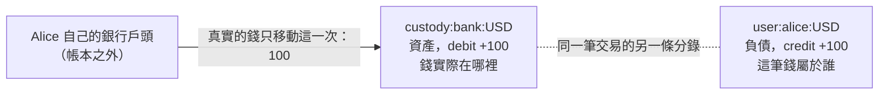
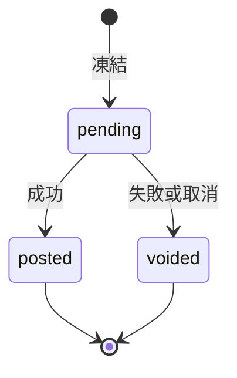

Hi 大家，在這個 AI 盛行的時代，我有一段時間沒有人工去寫文章了，剛好最近有一個機會，讓我可以重新整理一下自己對於 Ledger Domain 的一些基本認識與學習歷程，想要做個簡單分享。

##  什麼是 Ledger ？
Ledger 翻譯過來其實就是帳本的意思，那有天早上，我想說既然最近都在碰量化交易這一塊，那要不也來了解一下 Ledger 的相關知識以及相關的系統設計好了，於是我就開始了跟 Claude Code 的學習之旅。

以下就以 Claude Code 的回答讓大家知道什麼是 Ledger

> 帳本記錄的是每一筆資金的移動。系統裡任何一筆錢的變化，都要能說出它從哪裡來、到哪裡去，而且整本帳加總起來永遠是 0。做到這件事的記帳方法叫做複式記帳（Double-Entry Bookkeeping），每一次移動至少記兩筆：一筆記錢離開的地方，一筆記錢抵達的地方。

我給它的情境是「電子錢包加上交易所」，要求不可透支、要支援多幣別，資料庫用 PostgreSQL。原本只是想聊系統設計，結果光是基本觀念就來回問了好幾輪，其中有好幾個地方我一開始完全理解錯，所以這篇會把那些卡住的點也一起記下來。

## 為什麼不能只存一個 balance 欄位

最直覺的錢包設計，是每個使用者一個 `balance` 欄位，轉帳時把 A 減掉、把 B 加上：

```sql
UPDATE wallet SET balance = balance - 30 WHERE user_id = 'A';
UPDATE wallet SET balance = balance + 30 WHERE user_id = 'B';
```

小規模下這樣可以動，問題出在出錯的時候。第二行失敗，30 元就從系統裡消失了；某天餘額對不上，也沒辦法回推是哪一筆造成的，因為「這 30 元從哪裡來、到哪裡去」從來沒有被記下來。

複式記帳的做法是改成記錄每一次移動：

```text
交易 #1024  轉帳
  debit  user:A:USD   30
  credit user:B:USD   30
```

餘額不再是直接被改寫的欄位，而是把所有紀錄加總算出來的結果。任何時點的餘額都能重算，也能拿來對帳。

## 帳是誰的 ?

這裡是第一個讓我卡住的地方， Claude 說「使用者錢包在帳上是負債」。

這裡說的是**負債**，關鍵在於整個系統只有一本帳，而且是**平台自己的帳**。Alice 存進平台的 100 元不屬於平台，平台隨時要還給她，所以站在平台的角度，這 100 元是平台欠 Alice 的錢，也就是負債。Alice 的錢包餘額照樣顯示 +100。

這跟我們在銀行存款是同一件事。同樣一筆存款，對存款人來說是資產，對銀行來說是負債，只是看的角度不同。我們設計的帳本站在平台的角度，所以使用者錢包記成負債，平台在銀行或冷錢包裡實際持有的錢記成資產。

另一個我搞錯的點是「錢包跟平台的帳是兩本帳」。其實錢包不是另一本帳，它只是平台帳本裡的一個帳戶。真正在帳本之外的，是 Alice 自己在她銀行的戶頭。

## Debit 與 Credit

一開始 Claude 用「借」和「貸」來解釋，我讀得很吃力，後來請它全部改成英文的 debit 和 credit 對我來說好懂很多，所以這篇也就沿用英文。

debit 和 credit 只是分錄的兩個方向，本身不代表增加或減少，也不代表好壞。哪個方向會讓餘額增加，取決於帳戶的類型：

| 帳戶類型                                           | 帳戶記的是什麼     | 增加   | 減少   | 例子                                                      |
|:---------------------------------------------------|:-------------------|:-------|:-------|:----------------------------------------------------------|
| 資產（asset）、費用（expense）                     | 平台實際持有的東西 | debit  | credit | `custody:bank:USD` 平台的銀行戶頭                         |
| 負債（liability）、權益（equity）、收入（revenue） | 錢屬於誰、從哪裡來 | credit | debit  | `user:alice:USD` 使用者錢包、`revenue:fee:USD` 手續費收入 |

我中間有一版理解是「對平台的帳戶來說，credit 是進、debit 是出」，但這條規則在使用者錢包和手續費收入上成立，但碰到平台的銀行戶頭就要反過來，因為銀行戶頭代表的是平台方。

再來我就改口成「我們自己開的帳戶 credit 增加，銀行戶頭 debit 增加」，這在大部分情況會對，但分類的依據其實不是「誰開的帳戶」。平台自己開的冷錢包、換匯用的流動性部位，記的都是平台實際持有的資產，一樣是 debit 增加。最後留下來的判斷方法只有一個問題：

> 這個帳戶記的是「錢實際在哪裡」，還是「錢屬於誰」？

- 記的是**錢實際在哪裡**，例如平台的銀行戶頭：這是資產帳戶，debit 增加。
- 記的是**錢屬於誰**，例如屬於 Alice 的使用者錢包、屬於平台自己的手續費收入：這是負債或收入帳戶，credit 增加。

舉個例子，假設平台的銀行戶頭裡有 1,000 USD，這筆錢可以用兩種方式描述：

| 回答的問題 | 帳戶                              |  金額 |
|:-----------|:----------------------------------|------:|
| 錢在哪裡   | `custody:bank:USD` 平台的銀行戶頭 | 1,000 |
| 錢屬於誰   | `user:alice:USD` 屬於 Alice       |   600 |
| 錢屬於誰   | `user:bob:USD` 屬於 Bob           |   300 |
| 錢屬於誰   | `revenue:fee:USD` 屬於平台自己    |   100 |

同樣是這 1,000 元，第一列說它放在銀行，其餘三列說它分別是誰的，兩邊加總一定相等。Alice 轉 30 給 Bob 時，銀行裡的錢沒有動，只有「錢屬於誰」那幾列從 Alice 改成 Bob；只有入金、出金這種錢真正進出平台的操作，兩邊才會一起變動。

## 入金只動一次錢，卻記兩條分錄

搞懂 debit 和 credit 之後，我接著問：Alice 從銀行入金到平台，是不是要先「入金到平台」，再「入金到她的錢包」，總共入兩次？

答案是錢只移動一次，帳本用一筆交易、兩條分錄記下這一次移動：



圖中的實線是真實世界裡錢的移動，只有一次；虛線不是另一次移動，而是同一筆交易裡的第二條分錄。debit `custody:bank:USD` 記的是「平台的銀行多了 100」，credit `user:alice:USD` 記的是「這 100 屬於 Alice」，一邊 debit 100、一邊 credit 100，所以平衡。

平台的銀行戶頭通常是一個共用的資金池，所有使用者的錢都放在裡面，錢包則記錄池子裡有多少是誰的。因此兩邊永遠要對得上：

```text
custody:bank:USD（資產） = Σ user:*:USD（負債） + revenue:*:USD（收入）
```

這條等式對不上，就代表帳出錯了，它也是對帳最基本的檢查。

## 交易與分錄的三條規則

一次業務動作，例如入金、轉帳或成交，在帳上是一筆**交易（Transaction）**，裡面包含兩條以上的**分錄（Entry）**。以 Alice 轉 30 給 Bob、手續費 1 為例：

| 帳戶              | debit | credit |
|:------------------|------:|-------:|
| `user:alice:USD`  |    31 |        |
| `user:bob:USD`    |       |     30 |
| `revenue:fee:USD` |       |      1 |
| 合計              |    31 |     31 |

帳本要保證三件事：

- **平衡**：每筆交易的 Σdebit 必須等於 Σcredit，不相等就整筆拒絕寫入。
- **原子**：所有分錄和帳戶餘額的更新必須在同一個資料庫交易裡完成，不能只寫一半。
- **不可變**：分錄寫入後不能修改或刪除。記錯了就再寫一筆方向相反、金額相同的**沖正交易（Reversal）**，原紀錄保留，稽核時看得到錯誤和更正。

## 從資料結構看 Debit 與 Credit

真正讓 debit 和 credit 在我腦中定下來的，是把它放進資料結構裡看。下面的程式碼取自我後來實作的專案：

```go
// internal/ledger/transaction.go
type Direction string

const (
	Debit  Direction = "debit"
	Credit Direction = "credit"
)

type Entry struct {
	AccountCode string
	AssetCode   string
	Direction   Direction
	Amount      decimal.Decimal
}
```

debit 和 credit 只是分錄上的一個 `Direction` 欄位，金額永遠是正數，不用正負號表示方向。帳戶身上存的是累計值，寫入一條分錄時只做一件事：依 `Direction` 把金額加到 `Debits` 或 `Credits` 那一欄。「餘額增加還是減少」是讀取的時候，才依帳戶類型算出來的：

```go
// internal/ledger/account.go
func (t AccountType) NormalSide() Direction {
	if t == AccountTypeAsset || t == AccountTypeExpense {
		return Debit
	}
	return Credit
}

func (a *Account) Balance() decimal.Decimal {
	if a.Type.NormalSide() == Debit {
		return a.PostedDebits.Sub(a.PostedCredits)
	}
	return a.PostedCredits.Sub(a.PostedDebits)
}
```

寫入的時候不需要知道「這筆是增加還是減少」，這點對我來說是最大的釋懷。前面那張類型對照表，在程式裡就只是 `NormalSide()` 這幾行。

## 餘額的四個欄位與不可透支

加入「凍結」的概念之後，一個餘額數字已經不夠用，每個帳戶要記四個累計值：

| 欄位             | 意思                        |
|:-----------------|:----------------------------|
| `PostedDebits`   | 已確定的 debit 總額         |
| `PostedCredits`  | 已確定的 credit 總額        |
| `PendingDebits`  | 凍結中、可能會發生的 debit  |
| `PendingCredits` | 凍結中、可能會發生的 credit |

可用餘額的算法是已過帳餘額，扣掉凍結中的支出：

```go
// internal/ledger/account.go
func (a *Account) Available() decimal.Decimal {
	if a.Type.NormalSide() == Debit {
		return a.Balance().Sub(a.PendingCredits)
	}
	return a.Balance().Sub(a.PendingDebits)
}
```

這裡有一個保守的原則：凍結中的支出要扣掉，凍結中的收入卻**不能**加上，因為那筆錢還可能被作廢。「不可透支」的判斷就建立在這個數字上，只要扣款後的可用餘額小於 0，整筆交易拒絕。

舉例來說，Alice 入金 100，接著申請提領 30 並凍結。這時她的帳面餘額是 100，可用餘額是 70。如果她再轉 80 給 Bob，帳面上看起來夠，但可用餘額不夠，交易會被拒絕。

## 兩階段：先凍結再決定

有些業務在發起時，還不知道最後會不會成功，這時就需要兩階段交易：先寫一筆 `pending` 交易把錢凍結，結果出來再決定要過帳還是作廢。



一筆 pending 交易只能被處理一次，過帳之後不能再作廢，作廢之後也不能再過帳。常見的場景有這幾種：

| 場景                     | 為什麼要先凍結                             | 成功                       | 失敗             |
|:-------------------------|:-------------------------------------------|:---------------------------|:-----------------|
| 提領到銀行或鏈上         | 外部付款要幾秒到幾天，這段時間錢不能被花掉 | 銀行或鏈上確認後過帳       | 作廢，錢回到可用 |
| 商戶預授權（叫車、訂房） | 下單時還不知道最終金額                     | 依實際金額過帳，剩下的釋放 | 逾期自動作廢     |
| 鏈上入金等待確認         | 交易可能因為鏈重組而消失                   | 達到足夠確認數後才能使用   | 作廢             |
| 大額轉帳風控             | 要等人工審核                               | 通過後過帳                 | 拒絕就作廢       |

### Withdrawal 與 Withdrawal Settlement

設計出金時，我發現它被拆成兩筆交易，一開始覺得多此一舉。後來才理解，這兩筆記的是兩件不同的事：

- **withdrawal**：這筆錢不再屬於 Alice，她的錢包被扣款。
- **withdrawal settlement**：這筆錢真的離開了平台的銀行戶頭。

中間靠一個過渡帳戶 `clearing:withdrawal:USD` 銜接，它代表「已經從使用者扣下、但還沒從銀行付出去的錢」。以 Alice 提領 30 為例，三個帳戶的餘額變化如下：

| 時間點              | `user:alice:USD` | `clearing:withdrawal:USD` | `custody:bank:USD` |
|:--------------------|-----------------:|--------------------------:|-------------------:|
| 提領前              |              100 |                         0 |                100 |
| 申請提領（pending） |   100（可用 70） |              0（凍結 30） |                100 |
| 提領過帳（posted）  |               70 |                        30 |                100 |
| 結算（settlement）  |               70 |                         0 |                 70 |

拆開的原因是，在真實世界裡「使用者錢包被扣款」和「錢離開平台的銀行」通常不是同一個時間點。`custody:bank:USD` 必須跟銀行對帳單一致，銀行還沒真正扣款，帳上的託管餘額就不應該先減少；多筆提領也可能合併成一次銀行轉帳，這時會有很多筆 withdrawal，但只有一筆 settlement。`clearing:withdrawal` 的餘額本身就是一個營運上會看的數字：目前還在路上的提領總額。

老實說，目前我的實作是在同一個請求裡同時完成過帳與結算，先把兩筆交易拆開，是為了之後能把結算移到「匯入銀行對帳單」的時候才記，而不用動到提領本身的流程。

## 交易所掛單：為什麼不用 pending

接著，我把場景換到交易所的掛單，交易所的掛單也需要把錢鎖住，否則同一筆錢可以掛兩張單。原本以為直接用 pending 就好，但它在這裡有兩個問題：

- **掛單時不知道對方**。pending 交易需要指定錢最後要給誰，但掛單當下還沒有人跟它成交。
- **一張單會分很多次成交**。可能先成交 0.4 BTC，再成交 0.6 BTC，而一筆 pending 只能被處理一次。

Claude 説常見的做法是幫每位使用者的每種幣，再開一個 `in_order` 子帳戶。掛單就是一筆普通的已過帳交易，把錢從可用帳戶搬到 `in_order`：

| 動作     | 分錄                                                        |
|:---------|:------------------------------------------------------------|
| 掛單     | debit `user:alice:USDT` / credit `user:alice:USDT:in_order` |
| 每次成交 | debit `user:alice:USDT:in_order` / credit 對手方帳戶        |
| 撤單     | debit `user:alice:USDT:in_order` / credit `user:alice:USDT` |

每次部分成交都是一筆獨立的交易，對帳也直觀：`in_order` 的餘額應該等於撮合引擎裡尚未成交的掛單總額。最後整理出來的分工是，外部、一次性的流程用 pending，交易所掛單用 `in_order` 子帳戶。

## 多幣別：每種幣各自平衡

多幣別的規則是每個帳戶只放一種幣，一筆交易裡可以有多種幣，但**每一種幣都要自己平衡**。60,000 USDT 和 1 BTC 是不同的東西，不能互相抵銷。

以 Alice 用 60,000 USDT 向 Bob 買 1 BTC、雙方手續費各 0.1% 為例，一筆交易裡有四組分錄：

| 幣別 | debit                      | credit             |   金額 | 說明             |
|:-----|:---------------------------|:-------------------|-------:|:-----------------|
| USDT | `user:alice:USDT:in_order` | `user:bob:USDT`    | 59,940 | Bob 賣出所得     |
| USDT | `user:alice:USDT:in_order` | `revenue:fee:USDT` |     60 | Bob 的手續費     |
| BTC  | `user:bob:BTC:in_order`    | `user:alice:BTC`   |  0.999 | Alice 買到的 BTC |
| BTC  | `user:bob:BTC:in_order`    | `revenue:fee:BTC`  |  0.001 | Alice 的手續費   |

USDT 這邊 debit 60,000 等於 credit 59,940 加 60，BTC 這邊 debit 1 等於 credit 0.999 加 0.001，兩種幣各自平衡，四條分錄一起原子寫入。

另一個要注意的是精度。TWD 沒有小數，USD 到分（2 位），BTC 到 satoshi（8 位），ETH 到 wei（18 位）。所以需要一張資產主檔記錄每種幣的精度，金額用 decimal 或整數最小單位儲存，不能用浮點數。

## 冪等：重送不能扣兩次款

網路逾時的時候，呼叫端會重送請求，帳本如果照單全收，就會扣兩次款。解法是每筆寫入都帶一個唯一的 `Idempotency-Key`，帳本看到重複的 key，不再寫入，而是回傳第一次的結果。

實作時多做了一件事：同一個 key 如果配上**不同內容**的請求，例如第一次入金 100、第二次用同一個 key 入金 99，就回傳 409，而不是默默回傳舊結果。做法是把請求內容算成一個 fingerprint 跟交易一起存，重送時比對。

## 動手實作：go-ledger

觀念大致理清之後，我請 Claude Code 用 Go 直接實作入金、出金、轉帳、掛單四類 API，資料庫用 PostgreSQL。分層如下：

```text
cmd/ledgerd          組裝：設定、logger、DB 連線、migration、HTTP server
internal/httpapi     HTTP 傳輸層
internal/wallet      入金、出金、轉帳 → 組成交易請求
internal/exchange    掛單 → 計算鎖定金額、組成鎖定交易
internal/chart       科目表：所有帳戶代碼
internal/ledger      核心規則：驗證、套用、結清，不做 I/O
internal/postgres    唯一寫 SQL 的地方
```

這裡延續前面「帳本不懂業務」的想法：`ledger` 只認識「哪個帳戶、什麼方向、多少錢」，「入金」「掛單」這些概念放在 `wallet` 和 `exchange`，由它們把業務翻譯成分錄。

寫入一筆交易時，資料庫裡依序做這幾件事：

1. 載入相關的資產，驗證行數、金額精度，以及每種幣是否各自平衡。
2. 寫入交易紀錄，冪等 key 衝突時改成回傳原交易。
3. 開立還不存在的帳戶，再用 `SELECT ... ORDER BY id FOR UPDATE` 依固定順序鎖住所有相關帳戶，避免兩筆交易互相等待而 deadlock。
4. 在記憶體裡套用分錄，檢查有沒有帳戶透支。
5. 寫入分錄，批次更新帳戶的累計值。

資料庫層也留了兩道防線：`accounts` 上有一條 CHECK constraint，不可透支的帳戶可用餘額不能小於 0；`entries` 上有 trigger，擋下任何 UPDATE 和 DELETE。應用程式的檢查漏掉時，資料庫還會擋一次。

跑完一輪入金、提領、轉帳、掛單之後，我直接在資料庫裡檢查每個幣別的 Σdebit 減 Σcredit，已過帳和凍結中的部分都是 0，每個帳戶存的餘額也和從分錄重算的結果一致。

## 小結

回頭看，這次學習卡最久的不是系統設計，而是 debit 和 credit 的概念。我前後換了多次說法才理解，最後留下來的是兩件事：帳是平台的帳，以及「這個帳戶記的是錢在哪裡，還是錢屬於誰」。把它們放進資料結構之後，寫入時只管方向，餘額怎麼讀交給帳戶類型，很多原本覺得反直覺的地方就順了。

目前的實作還沒有撮合成交、撤單、pending 逾時自動作廢，也還沒談到百萬級流量下的熱點帳戶和分片，這些留到下一篇再整理( 有機會的話....)。

## Reference

- [Debit 與 credit 的方向、帳戶的 debits_posted / credits_posted 等欄位設計 — TigerBeetle Docs, Data Modeling](https://docs.tigerbeetle.com/coding/data-modeling/)
- [Pending、post、void 的兩階段轉帳語意 — TigerBeetle Docs, Two-Phase Transfers](https://docs.tigerbeetle.com/coding/two-phase-transfers/)
- [資產、負債與 normal balance 方向的入門說明 — Modern Treasury, Accounting for Developers Part I](https://www.moderntreasury.com/journal/accounting-for-developers-part-i)
- [以固定順序取得鎖來避免 deadlock — PostgreSQL Documentation, Explicit Locking](https://www.postgresql.org/docs/current/explicit-locking.html)
- [`Idempotency-Key` header 的語意與重送處理 — IETF HTTPAPI, The Idempotency-Key HTTP Header Field](https://datatracker.ietf.org/doc/draft-ietf-httpapi-idempotency-key-header/)
- [API 錯誤回應的 problem details 格式 — RFC 9457, Problem Details for HTTP APIs](https://www.rfc-editor.org/rfc/rfc9457)
