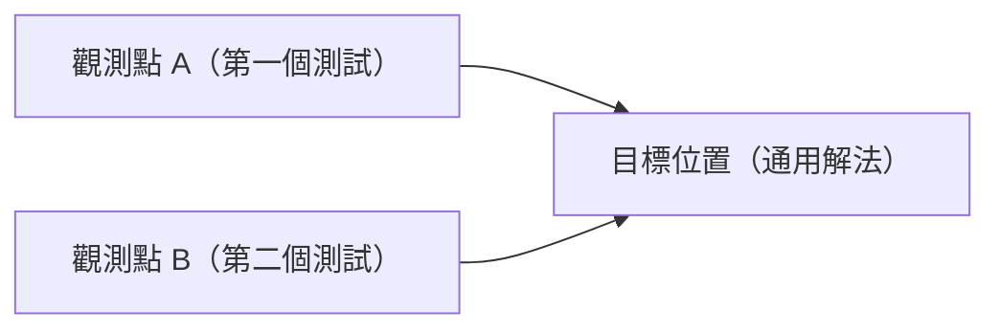

Hi all，最近文藝復興啊，嘗試挑幾道題目用手寫的方式寫 TDD ，常常會遇到幾個 moment：第一個測試寫好了，紅燈也亮了，接著要讓它變綠。最快的做法是直接 `return` 一个寫死的值，測試就過了。

這樣做當然不是我們想要的程式，但它也沒有錯，因為目前唯一的需求證據就只有那一個測試。問題是，接下來要怎麼從「寫死」走到「通用」？什麼時候才算有足夠的理由把程式抽象化？

三角測量法（Triangulation）就是在回答這個問題。這篇會先說明它的概念，再用 Golang 寫一個分期金額計算的例子，從第一個紅燈一路走到完成。

## 名字的由來

三角測量原本是測量學的方法。要知道遠方某個點的位置，只從一個觀測點看過去，只能知道它在某個「方向」上，但不知道距離。換到第二個觀測點再看一次，兩條視線的交點才能把位置確定下來。



圖中兩條箭頭各代表一個測試提供的線索，實作要落在兩條線索交會的位置。套到 TDD 上：

- **一個測試案例**只能告訴我們「在這個輸入下，答案是這個」。能滿足它的實作有無限多種，寫死回傳值也是其中一種。
- **第二個、方向不同的測試案例**會讓寫死的實作失效，迫使我們找出能同時滿足兩者的規則。

所以三角測量法的核心規則只有一條：**只有在兩個以上的例子同時要求時，才把程式抽象化。** 抽象化的方向由例子之間的差異決定，不靠我們事先猜。

## 讓測試變綠的三種策略

TDD 裡讓紅燈變綠，常見有三種做法，三角測量是其中之一：

| 策略                   | 做法                                                     | 適合的時機                 |
|:-----------------------|:---------------------------------------------------------|:---------------------------|
| Fake It                | 先回傳寫死的值，讓測試通過，之後再一步步把常數換成變數   | 剛開始、對實作還沒有把握   |
| Obvious Implementation | 直接寫出正確的實作                                       | 答案很明顯，例如兩數相加   |
| Triangulation          | 先寫死，再補一個方向不同的例子，讓兩個例子共同逼出通用解 | 不確定正確的抽象長什麼樣子 |

三者可以混用，依照當下的把握程度換檔。很有把握時用 Obvious Implementation，一旦寫出來的東西出乎意料地紅燈了，就退回 Fake It 加 Triangulation，把步伐縮小。

## 情境：分期付款的每期金額

假設我們要做一個分期付款功能，把一筆總金額拆成 N 期。業務規則如下：

1. 金額以「元」為單位，用整數表示，不處理小數。
2. 能整除時，每期金額相同。
3. 不能整除時，**每期金額的差距不得超過 1 元**，多出來的零頭從第一期開始，依序每期多收 1 元。
4. 期數必須大於 0、總金額不得為負數，否則回傳錯誤。

規則 3 是這個例子的重點，例如 1000 元分 3 期，應該是 `[334, 333, 333]`，而不是 `[333, 333, 334]`，也不是 `[335, 333, 332]`。

我們要做的是一個 `InstallmentCalculator`，提供 `Split(totalAmount, numberOfInstallments)` 方法。測試放在 `tests/` 底下，用外部的 `installment_test` package，只透過公開介面測行為。

## Step 1：第一個紅燈

挑一個最單純的例子：300 元分 3 期。

```go
// tests/installment_calculator_test.go
func TestSplit_300Into3_Returns100Each(t *testing.T) {
	calculator := installment.InstallmentCalculator{}

	installments, err := calculator.Split(300, 3)

	assert.NoError(t, err)
	assert.Equal(t, []int{100, 100, 100}, installments)
}
```

此時 `InstallmentCalculator` 還不存在，編譯不過，這就是第一個紅燈。

## Step 2：寫死讓它變綠（Fake It）

```go
// installment_calculator.go
type InstallmentCalculator struct{}

func (calculator InstallmentCalculator) Split(totalAmount int, numberOfInstallments int) ([]int, error) {
	return []int{100, 100, 100}, nil
}
```

測試通過。這段程式碼看起來很蠢，但它誠實反映了目前的狀態：我們手上只有一個例子，這個例子沒有告訴我們 `100` 是怎麼來的。它可能是 `300 / 3`，也可能是「固定每期 100 元」的商品方案。在第二個例子出現之前，任何猜測都是我們自己加進去的需求。

## Step 3：第二個觀測點，只改總金額

接下來補第二個例子。這裡有個關鍵：**一次只改變一個維度**。如果同時改總金額和期數，紅燈時就分不清楚是哪個維度需要泛化。

先固定期數，只改總金額：600 元分 3 期。

```go
// tests/installment_calculator_test.go
func TestSplit_600Into3_Returns200Each(t *testing.T) {
	calculator := installment.InstallmentCalculator{}

	installments, err := calculator.Split(600, 3)

	assert.NoError(t, err)
	assert.Equal(t, []int{200, 200, 200}, installments)
}
```

寫死的 `100` 失效，紅燈。兩個例子放在一起看，`300 → 100`、`600 → 200`，能同時滿足兩者的規則就是「總金額除以 3」：

```go
// installment_calculator.go
func (calculator InstallmentCalculator) Split(totalAmount int, numberOfInstallments int) ([]int, error) {
	baseAmount := totalAmount / 3
	return []int{baseAmount, baseAmount, baseAmount}, nil
}
```

注意這裡的 `3` 還是寫死的。目前兩個例子的期數都是 3，沒有任何證據要求期數可變，所以這一步只泛化「總金額」這個維度。

## Step 4：第三個觀測點，只改期數

這次固定總金額的性質（仍然整除），改期數：400 元分 2 期。

```go
// tests/installment_calculator_test.go
func TestSplit_400Into2_Returns200Each(t *testing.T) {
	calculator := installment.InstallmentCalculator{}

	installments, err := calculator.Split(400, 2)

	assert.NoError(t, err)
	assert.Equal(t, []int{200, 200}, installments)
}
```

目前的實作會回傳 `[133, 133, 133]`，長度和金額都不對，紅燈。這次被逼出來的是期數這個維度：

```go
// installment_calculator.go
func (calculator InstallmentCalculator) Split(totalAmount int, numberOfInstallments int) ([]int, error) {
	baseAmount := totalAmount / numberOfInstallments

	installments := make([]int, numberOfInstallments)
	for index := range installments {
		installments[index] = baseAmount
	}
	return installments, nil
}
```

到這裡，整除的情況已經完整了。三個例子各自負責一件事：第一個建立基準，第二個逼出總金額的除法，第三個逼出期數的長度。

## Step 5：零頭出現了

接下來處理不能整除的情況：1000 元分 3 期，期望 `[334, 333, 333]`。

```go
// tests/installment_calculator_test.go
func TestSplit_1000Into3_PutsRemainderOnFirstInstallment(t *testing.T) {
	calculator := installment.InstallmentCalculator{}

	installments, err := calculator.Split(1000, 3)

	assert.NoError(t, err)
	assert.Equal(t, []int{334, 333, 333}, installments)
}
```

目前的實作會回傳 `[333, 333, 333]`，少了 1 元，紅燈。

最小的修改是把餘數加到第一期：

```go
// installment_calculator.go
func (calculator InstallmentCalculator) Split(totalAmount int, numberOfInstallments int) ([]int, error) {
	baseAmount := totalAmount / numberOfInstallments
	remainder := totalAmount % numberOfInstallments

	installments := make([]int, numberOfInstallments)
	for index := range installments {
		installments[index] = baseAmount
	}
	installments[0] += remainder
	return installments, nil
}
```

測試通過。但這裡值得停下來想一下：這個實作真的符合規則 3 嗎？

規則說「零頭從第一期開始，依序每期多收 1 元」。當零頭剛好是 1 的時候，「全部加在第一期」和「依序每期加 1」的結果完全一樣，一個例子區分不出兩種寫法。這正是只有一個觀測點時的盲區：我們確定答案在某條線上，但不確定在線上的哪裡。

## Step 6：用第二個零頭案例逼出真正的規則

要區分這兩種寫法，需要一個零頭大於 1 的例子：1001 元分 3 期，零頭是 2，期望 `[334, 334, 333]`。

```go
// tests/installment_calculator_test.go
func TestSplit_1001Into3_SpreadsRemainderFromFirstInstallment(t *testing.T) {
	calculator := installment.InstallmentCalculator{}

	installments, err := calculator.Split(1001, 3)

	assert.NoError(t, err)
	assert.Equal(t, []int{334, 334, 333}, installments)
}
```

Step 5 的實作會回傳 `[335, 333, 333]`，第一期和第三期差了 2 元，違反「差距不得超過 1 元」，紅燈。兩個零頭案例放在一起，規則就清楚了：前 `remainder` 期各多 1 元。

```go
// installment_calculator.go
func (calculator InstallmentCalculator) Split(totalAmount int, numberOfInstallments int) ([]int, error) {
	baseAmount := totalAmount / numberOfInstallments
	remainder := totalAmount % numberOfInstallments

	installments := make([]int, numberOfInstallments)
	for index := range installments {
		installments[index] = baseAmount
		if index < remainder {
			installments[index]++
		}
	}
	return installments, nil
}
```

所有測試通過。

這一步也說明了三角測量在實務上的另一個價值：在找第二個例子的時候，我們被迫去思考「零頭是 2 的時候應該長怎樣」。如果規格當初沒寫清楚，這就是該回頭跟需求方確認的時機。很多規格上的模糊地帶，是在挑選第二個例子時才被發現的。

## Step 7：錯誤處理，直接寫就好

規則 4 的兩個錯誤情境只是輸入檢查，規格已經寫明要擋什麼，沒有待釐清的抽象，這時候換成 Obvious Implementation，一次寫完：

```go
// tests/installment_calculator_test.go
func TestSplit_NonPositiveNumberOfInstallments_ReturnsError(t *testing.T) {
	calculator := installment.InstallmentCalculator{}

	_, err := calculator.Split(1000, 0)

	assert.ErrorIs(t, err, installment.ErrInvalidNumberOfInstallments)
}

func TestSplit_NegativeTotalAmount_ReturnsError(t *testing.T) {
	calculator := installment.InstallmentCalculator{}

	_, err := calculator.Split(-1, 3)

	assert.ErrorIs(t, err, installment.ErrNegativeTotalAmount)
}
```

```go
// installment_calculator.go
var ErrInvalidNumberOfInstallments = errors.New("number of installments must be positive")
var ErrNegativeTotalAmount = errors.New("total amount must not be negative")

func (calculator InstallmentCalculator) Split(totalAmount int, numberOfInstallments int) ([]int, error) {
	if numberOfInstallments <= 0 {
		return nil, ErrInvalidNumberOfInstallments
	}
	if totalAmount < 0 {
		return nil, ErrNegativeTotalAmount
	}

	// ...其餘不變
}
```

期數為 0 的檢查順便擋掉了 `totalAmount / 0` 的 panic。這項檢查從規格就能直接推得，硬要先寫死再補例子，只會讓步伐變得冗長。

## Step 8：重構測試，讓觀測點排在一起

一路寫下來，五個成功案例的測試結構完全相同，只有輸入和期望值不同。這正好是 Golang table-driven test 的形狀，重構時順便用 `name` 標註每個例子負責的維度：

```go
// tests/installment_calculator_test.go
package installment_test

import (
	"testing"

	"example.com/installment"
	"github.com/stretchr/testify/assert"
)

func TestSplit(t *testing.T) {
	testCases := []struct {
		name                 string
		totalAmount          int
		numberOfInstallments int
		expected             []int
	}{
		{"整除的基準點", 300, 3, []int{100, 100, 100}},
		{"只改總金額", 600, 3, []int{200, 200, 200}},
		{"只改期數", 400, 2, []int{200, 200}},
		{"零頭為 1", 1000, 3, []int{334, 333, 333}},
		{"零頭為 2", 1001, 3, []int{334, 334, 333}},
	}

	calculator := installment.InstallmentCalculator{}
	for _, testCase := range testCases {
		t.Run(testCase.name, func(t *testing.T) {
			installments, err := calculator.Split(testCase.totalAmount, testCase.numberOfInstallments)

			assert.NoError(t, err)
			assert.Equal(t, testCase.expected, installments)
		})
	}
}
```

完成後的 production code：

```go
// installment_calculator.go
package installment

import "errors"

var ErrInvalidNumberOfInstallments = errors.New("number of installments must be positive")
var ErrNegativeTotalAmount = errors.New("total amount must not be negative")

type InstallmentCalculator struct{}

func (calculator InstallmentCalculator) Split(totalAmount int, numberOfInstallments int) ([]int, error) {
	if numberOfInstallments <= 0 {
		return nil, ErrInvalidNumberOfInstallments
	}
	if totalAmount < 0 {
		return nil, ErrNegativeTotalAmount
	}

	baseAmount := totalAmount / numberOfInstallments
	remainder := totalAmount % numberOfInstallments

	installments := make([]int, numberOfInstallments)
	for index := range installments {
		installments[index] = baseAmount
		if index < remainder {
			installments[index]++
		}
	}
	return installments, nil
}
```

`go test ./...` 跑下來，七個案例全部通過。

可能有人會懷疑，三角測量完成之後，那些當初用來「逼出抽象」的例子要不要刪掉？我自己的習慣是看它們還有沒有在描述不同的行為。上面「零頭為 1」和「零頭為 2」描述的是不同情境，留著；如果有兩個例子在重構後變得完全等價（例如 300/3 和 900/3），就可以只留一個，避免測試清單膨脹卻沒有增加資訊。

## 挑選觀測點的幾個原則

回頭整理整個過程，挑選第二個、第三個例子時，有幾件事會影響三角測量是否有效：

- **一次只改一個維度。** Step 3 只改總金額、Step 4 只改期數。同時改兩個，紅燈時就要同時猜兩件事，步伐變大，也更難看出抽象該往哪裡長。
- **新例子要能讓現有實作失敗。** 如果補的例子一寫就綠燈（例如在 Step 3 之後補 900 元分 3 期），它沒有提供新的方向，對三角測量沒有幫助。它可以當文件留著，只是推進設計的不是它。
- **特別留意「剛好相等」的例子。** Step 5 的零頭為 1，讓「全加在第一期」和「依序分攤」兩種寫法得到相同結果。邊界值常常有這種巧合，看到測試過得太輕鬆時，值得再想一下是否有另一種實作也能通過。
- **規格已經寫明時不必硬用。** Step 7 的錯誤處理直接寫出來即可。三角測量是在不確定時縮小步伐的工具，有把握的步驟可以跳過。

## 小結

三角測量法要解決的，是「什麼時候才有足夠的證據把程式抽象化」這個問題。它的做法是先承認一個例子給不出方向，然後刻意挑選方向不同的第二個例子，讓兩個例子的交集決定實作。

在分期金額的例子裡，總金額、期數、零頭分配這三個維度，各自是由一組例子逼出來的；而零頭分配那一步也說明了，只看一個例子時，錯誤的實作可以很安靜地通過測試。

實務上可能我也可能不太會這樣子，畢竟實際遇到的問題通常不會這麼乾淨，但這個方法提供了一個思路：**當不確定抽象長什麼樣子時，先承認一個例子給不出方向，再刻意挑選第二個例子逼出通用解。**

## Reference

- [三角測量在測量學中的原理：由兩個已知觀測點決定第三點位置 — Wikipedia, Triangulation (surveying)](https://en.wikipedia.org/wiki/Triangulation_(surveying))
- [Golang `t.Run` 子測試與 table-driven test 的寫法 — Go Wiki, TableDrivenTests](https://go.dev/wiki/TableDrivenTests)
- [`assert.Equal`、`assert.ErrorIs` 等斷言的用法 — stretchr/testify assert package](https://pkg.go.dev/github.com/stretchr/testify/assert)
