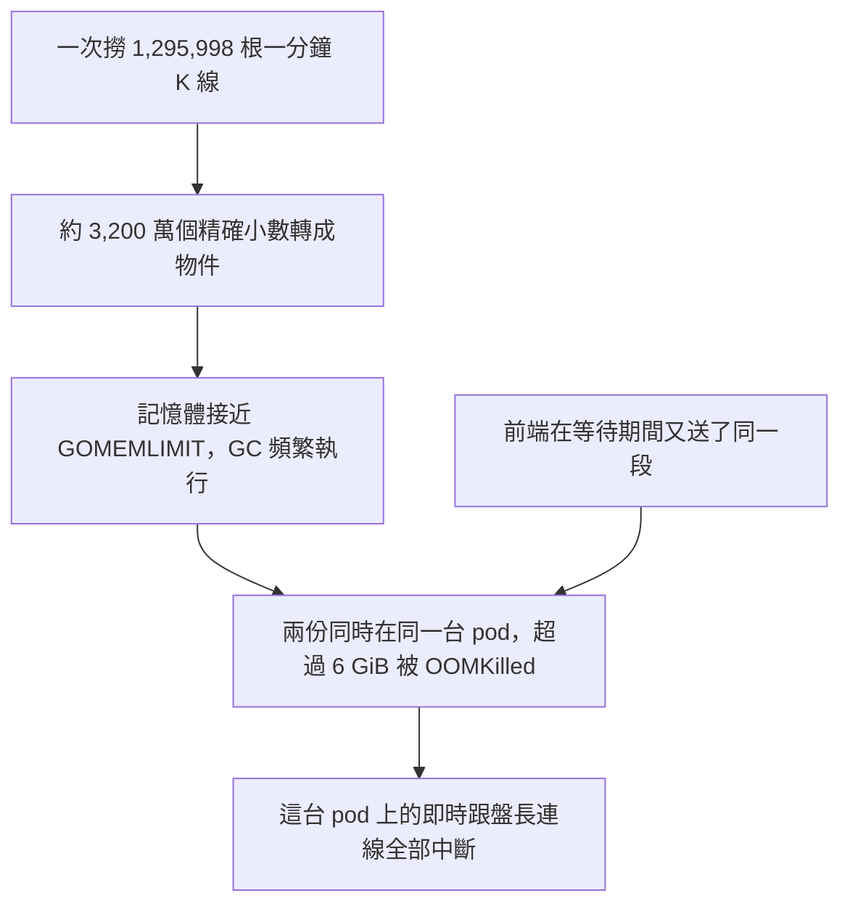

## 起因

最近在自己的交易服務上看盤時，K 線圖時不時會跳出一行提示：「即時更新已停止，正在重新連上。圖表顯示的是目前手上的資料。」過一陣子又自己好了，再過一陣子又出現。

另一個問題是速度。把圖切到日線、往左拖想看更早的走勢時，圖表要轉很久才把那一段接上來。

一開始我以為這是同一件事的兩個面向，追下去才發現是兩個問題，而且第二個問題會反過來製造第一個問題的症狀。這篇依照追查的順序記錄下來，最後整理上線前後的數字。

服務的架構先簡單交代：後端是 Go/Gin，前端是 TypeScript/Nuxt，部署在 k3s 上跑三個 replica，前面有 Cloudflare。即時 K 線是後端連幣安的 websocket，再用 Server-Sent Events 推給 Browser。

## 第一個問題：串流連得上，但什麼都不送

### 那句提示是怎麼來的

先找訊息從哪裡來。前端的跟盤 proxy 收到後端推來的 `stalled` 狀態，或是自己的連線斷掉時，都會顯示這句話。後端推 `stalled` 的條件是：連幣安的 websocket 30 秒沒收到任何資料，就判定死了，推一則 `stalled` 給所有看著它的人，然後退避重連。

所以要先分清楚是哪一種。看三個 replicas 的 log，其中一台在 10/17 的 04:05 到 15:21 之間，印了 487 次同一句話：

```text
live k candle follow: crypto| **BTCUSDT**  is not delivering; trying again in 30s
```

大約每分鐘一次，等於每次重連都是「連上、30 秒沒資料、判定斷線、等 30 秒再試」的循環，持續了 11 個小時。幣安的 proxy 從頭到尾沒有記錄任何連線錯誤，代表連線本身是成功的，只是沒有資料進來。

這裡有一個繞了一下的地方：log 裡的 `crypto| **BTCUSDT** ` 是現貨和合約共用的 key (ps. 現貨是 `stream.binance.com:9443/ws/ **BTCUSDT** @kline_1m`，合約是 `fstream.binance.com/ws/ **BTCUSDT** @kline_1m`)，看不出是哪一條線。對照那段時間的請求紀錄，才發現那 11 個小時剛好有人一直開著合約  **BTCUSDT**  的圖。

### 先排除一個假設

伺服器設了 `ReadTimeout: 30s`，而 Go 的 `http.Server` 在請求開始時會把讀取期限設到連線上。我第一個懷疑是timeout 之後，會連帶取消 SSE 請求的 context，導致每 30 秒被切一次。

與其推論，不如直接驗證。透過 AI 快速的使用 Go 寫一支小程式，`ReadTimeout` 設 2 秒，handler 每 300 毫秒寫一次事件，結果跑了 60 秒都沒被切斷。這個假設不成立，可以排除。

### 直接連幣安看看

剩下的懷疑對象就是幣安本身。用和後端同一個 websocket 套件、同樣的網址格式，三個串流各連 12 秒：

| 串流                                                                   | 第一則 | 12 秒內收到 |
|------------------------------------------------------------------------|--------|-------------|
| `stream.binance.com:9443/ws/ **BTCUSDT** @kline_1m`（現貨）            | 138 ms | 6 則        |
| `fstream.binance.com/ws/ **BTCUSDT** @kline_1m`（合約，原本用的）      | —      | 0 則        |
| `fstream.binance.com/market/ws/ **BTCUSDT** @kline_1m`（合約，新路徑） | 132 ms | 31 則       |

合約原本那條路徑還接受連線，但不送任何 K 線；同樣的串流放到 `/market` 路徑下就正常。這也解釋了為什麼後端不會記錄錯誤：連線沒有失敗，只是一直安靜。

修法本身很小：把 `CONTRACT_MARKET_DATA_STREAM_URL` 的預設值改成新路徑，部署設定也明確寫上這個變數。另外順手把跟盤的 log 加上線的名稱（`spot`、`spot relay`、`contract`）和完整的串流網址，下次同類的問題不必再對照請求紀錄才分得出是哪一條。上線後三個 replicas 都沒有再出現 `not delivering`。

## 第二個問題：切到日線要等半分鐘

### 量測

第一個問題修好之後，接著看慢的問題。正式環境的 log 裡，合約  **BTCUSDT**  切到日線時有兩種請求：

- 第一頁是最近一週的日線，151 毫秒[]()。
- 接著往左接更早的一段，範圍是 2024-04-25 到 2026-10-12，大約兩年半。四次請求分別花了 26.7、29.5、33.8、34.4 秒。

慢的是第二種。看後端怎麼處理這種請求：它先算出這段期間最多會有多少根一分鐘 K 線，把它們全部撈出來，再在程式裡依刻度合成日線。改動前的寫法大致是這樣：

```go
// internal/domain/service/k_candle_contract_service.go（改動前）
kCandleContracts, findError := kCandleContractService.kCandleContractRepository.FindInRange(
	executionContext, seriesQueryDomain.RangeQuery(), seriesQueryDomain.SourceCandleLimit())
if findError != nil {
	return dto.KCandleContractSeriesDto{}, findError
}

return seriesQueryDomain.ContractSeriesOf(kCandleContracts).ToDto(), nil
```

`SourceCandleLimit()` 算出來是九百天乘上每天 1,440 分鐘。在正式資料庫對同一段跑 `EXPLAIN ANALYZE`，實際回傳 1,295,998 列，資料庫本身只花了 0.49 秒，有走到 `(symbol, open_time)` 的索引。

所以時間不在資料庫。後端的 GORM log 記錄那兩支查詢分別是 50,376 毫秒和 52,810 毫秒，差的幾乎全部是把一百三十萬列轉成 Go 物件的時間成本。

### 慢為什麼會變成斷線

如果只是慢，頂多是多等一下。真正的問題是記憶體。合約 K 線每一列有價量、成交筆數、標記價格、指數價格、溢價指數，加起來約 25 個欄位，每個金額欄位都是 `numeric(38,18)`，讀進來後轉成 `shopspring/decimal`，背後各自配置一個 `big.Int`。一百三十萬列乘上 25 個欄位，大約是三千兩百萬個需要配置的值。

10/17 那天 17:48 到 17:49 之間，實際發生的順序是這樣：



那台 pod 在 17:49:06 以 exit 137 結束，原因欄位寫著 `OOMKilled`。最後的 log 就是那兩支同時在跑的 130 萬列查詢。pod 一重啟，連在上面的 SSE 長連線全部斷掉，瀏覽器又看到了那句「即時更新已停止」，策略機器人那一輪也跟著中斷。

圖裡有兩條路匯到 OOMKilled：
1. 一條是單次請求本身就很重
2. 前端在等待期間又送了一次同樣的請求。

我們來單獨說明第二條。前端每次圖表的可見範圍改變，都會重算一次要取哪一段；但手上的資料要等請求回來才會更新，所以在那三十秒裡只要看盤的人多動一下圖，算出來的還是同一段，於是又送一次。log 裡同一段請求在 17:48:10 和 17:48:12 各出現一次，分別落在兩個不同的 pod。

記憶體實際用到多少我沒有 profile，上面的物件數量是透過 AI 推算的。但 DB 只花 0.49 秒、轉換卻要 50 秒，加上 OOMKilled 的紀錄，方向是確定的。

## 優化的方向：先合好、留著

### 彙總規則可以分段做

要讓粗刻度變快，最直接的方式是不要每次都從一分鐘開始合。如果每一個走完的 UTC 日都事先把那一天的各小時與日 K 線合好存起來，往前看九百天的日線就只需要讀九百筆。

這個做法成立的前提，是合併規則可以分段進行：先把分鐘合成小時，再把小時合成天，結果要跟直接把分鐘合成天完全一樣。檢查一下現有的規則：

- 開盤取最早那根、收盤取最晚那根、最高取最大、最低取最小、成交數字加總，這些都可以分段做。
- 市場不報的成交數字（台股沒有成交金額），只要一格裡有任何一分鐘報了，就取有報的加總；全部都不報才是「不報」。分段做也一樣。
- 合約的指數價格與溢價指數，只要一格裡有任何一分鐘缺，整格就是缺。分段做的時候，只要某個小時是缺，往上合的那一天也是缺，結果一致。

既然規則可以分段，彙總好的資料就不需要另寫一套合併程式。把它轉回和一分鐘 K 線同樣的形狀，交給原本的合併程式處理就好，兩條路徑的結果因此不可能分岔。

### 一次請求怎麼切

有了留存的彙總，一次粗刻度請求就切成三段：

- 查詢範圍開頭不滿一格的那一段，用一分鐘 K 線合併。
- 中間每一個完整的格子，取留存的彙總：日線取日彙總，一小時取小時彙總，四小時由四份小時彙總合成。
- 結尾不滿一格的那一段，以及今天，仍用一分鐘 K 線合併。

當天不留存，因為今天還在走。合併的邏輯集中在 reader 裡，service 只管把結果交給原本的合併程式：

```go
// internal/domain/service/k_candle_summarized_series_reader.go
func (reader kCandleSummarizedSeriesReader) read(
	executionContext context.Context, seriesQueryDomain domains.KCandleSeriesQueryDomain, now time.Time,
) ([]entities.KCandle, error) {
	planDomain := domains.NewKCandleSummaryPlanDomain(seriesQueryDomain, now)
	if !planDomain.UsesSummaries() {
		return reader.kCandleRepository.FindInRange(
			executionContext, seriesQueryDomain.RangeQuery(), seriesQueryDomain.SourceCandleLimit())
	}

	summaries, summariesError := reader.summaries(executionContext, planDomain)
	if summariesError != nil {
		return nil, summariesError
	}

	sourceCandles := make([]entities.KCandle, 0, len(summaries))
	for _, summary := range summaries {
		sourceCandles = append(sourceCandles, summary.ToKCandle())
	}
	for _, minuteStretch := range planDomain.MinuteStretches() {
		minutes, findError := reader.kCandleRepository.FindInRange(
			executionContext, minuteStretch, minuteStretch.MinuteCapacity())
		if findError != nil {
			return nil, findError
		}
		sourceCandles = append(sourceCandles, minutes...)
	}

	return sourceCandles, nil
}
```

一分鐘、五分鐘、十五分鐘維持原本的路徑。這幾種刻度一次最多九百根，換算回一分鐘也只有一萬多列，本來就不是瓶頸。

### 讓留存的資料不會過期

留存最怕的是過期。這個服務裡會改動已經走完的分鐘的路徑比想像中多：例行抓取每分鐘會回頭重寫最近 25 分鐘（吸收來源的修正）、歷史同步會在任何一天補洞、合約舊資料的指數價格會被晚補上去，還有手動的增刪改。盤點下來總共九條寫入路徑。

我的做法是不去「更新」彙總，而是讓它「作廢」。九條路徑最後都會走到同一組 repository 的寫入方法，所以在那裡、在同一個資料庫交易內，把被改到的那一天的版本號加一，並刪掉那一天的彙總。下次有人要那一天時，發現沒有彙總，再重新合一次。因為作廢和寫入在同一個交易裡，不會出現「分鐘已經改了、彙總還是舊的」這種中間狀態被讀到。

還有一種比較隱晦的情況：一個請求正在合三月一日的時候，三月一日剛好有一根分鐘被改寫。合出來的結果是用舊資料算的，不能存下來。版本號就是為了這個：合併開始前先記下那一天的版本號，存的時候只有版本號沒變才寫入，否則就放棄，留給下一次。

### 限制單次的成本

彙總解決了「已經合好」的情況，但剛上線時一天都還沒合過，第一次往前看九百天怎麼辦？如果把九百天的分鐘一次搬進來合，就又回到原本的問題。

所以缺的日子是一天一天補：讀一天的分鐘（最多 1,440 根）、合出那一天、存下來，再處理下一天。補到一半失敗的話，已經補好的那幾天會留著，下一次從還缺的地方接下去。整次請求同時持有的分鐘，就是開頭和結尾各不滿一格的那兩段，最多約兩天份，跟查詢範圍多長無關。

另外有一個值班的背景工作，每五分鐘替觀察清單上的現貨和合約追蹤名單上的合約，補好最近兩天走完的日子。多數時候看圖的人不會遇到需要現場補的情況。

## 前端：同一段還在路上就不再要一次

前端要處理的是前面提到的重複請求。完全相同的請求（同一張圖、同一個標的、同一個起訖、同一種刻度）還在路上時，後到的人直接等同一份回來：

```ts
// app/infrastructure/proxy/in-flight-request-sharing.ts
export class InFlightRequestSharing<TResult> {
  private readonly requestsInFlight = new Map<string, Promise<TResult>>()

  share(requestKey: string, request: () => Promise<TResult>): Promise<TResult> {
    const requestInFlight = this.requestsInFlight.get(requestKey)
    if (requestInFlight !== undefined) {
      return requestInFlight
    }

    const sharedRequest = request().finally(() => this.requestsInFlight.delete(requestKey))
    this.requestsInFlight.set(requestKey, sharedRequest)

    return sharedRequest
  }
}
```

請求回來（不論成功或失敗）就在 `finally` 裡忘記它，所以這不是快取，失敗也不會被記住。它放在 proxy 這一層，因為「要求完全一樣，答案就完全一樣」只有知道 wire 格式的那一層能確定；現貨和合約的 proxy 各持有一份，兩張圖不會互相等待。

## 上線後的數字

| 項目                               | 改善前           | 改善後                                         |
|------------------------------------|------------------|------------------------------------------------|
| 合約串流 12 秒內收到的 K 線        | 0 則             | 31 則                                          |
| 同一段日線（約九百天）的伺服器耗時 | 26.7–34.4 秒     | 95.62 毫秒                                     |
| 同一段請求讀取的列數               | 1,295,998 列     | 約 2,339 列（899 筆日彙總加頭尾 1,440 根分鐘） |
| 同時有兩個相同請求時               | pod 被 OOMKilled | 前端只送一次；記憶體上限跟範圍無關             |
| 上線後的 pod 狀態                  | —                | 三台沒有重啟，記憶體 15–66 MiB                 |

第一次還沒彙總過的那一段，在正式環境補完大約花了 30 秒，期間記憶體維持平穩；之後同一段就是毫秒級。

彙總的正確性另外做了一次實地抽查：拿 2025-06-01 這一天的 96 根十五分鐘 K 線（走原本逐分鐘合併的路徑）自己合成一根日線，和留存彙總給的那一天比對。開高低收、成交量、成交金額、成交筆數、標記價格、指數價格、溢價指數，11 個欄位全部一致。

## 過程中記下來的幾件事

這次的開發流程是先寫需求共識和規格（BRIEF、PRD），再寫架構設計（ARCH），實作完之後做一次規格對照（contract），最後開 PR、code review 再合併。有幾件事值得記下來。

**規格對照抓到的是規格本身的錯。** PRD 裡我寫了「任何一次請求同時處理的一分鐘 K 線不超過一天份」，對照時發現實際設計是開頭和結尾各一段，最多約兩天份。記憶體一樣是平的、有上限，使用者要的「限制單次成本」沒有問題，問題在我把數字寫得太精確。處理方式是修正 PRD 的數字，並在對照紀錄裡寫明這是規格錯誤，而不是悄悄改掉預期值去配合程式碼。

**code review 抓到了兩個新設計帶來的問題。** 第一個是作廢時刪除彙總的條件只有標的和時間，但索引是 `(symbol, interval, open_time)`，PostgreSQL 17 沒辦法跳過中間那一欄，等於每次例行寫入都會掃過該標的全部的彙總。把刪除條件加上刻度之後，索引就能把範圍限定在那一天。第二個是查詢一個打錯的代號，或是歷史還沒同步的區段時，系統會一天一天補出上千個空的日子。現在補之前先用一次 `LIMIT 1` 查有沒有任何分鐘，沒有就不補。

**突變測試讓幾個看起來有在測的測試現形。** 寫完測試之後，刻意把程式改壞，確認對應的測試會變紅。有三個沒變紅：例如作廢時「刪除彙總」那一步被拿掉，測試仍然通過，因為讀取時本來就不會回傳未彙總那一天的資料。真正的影響要到那一天被重新彙總時才會出現（舊資料還在，新資料寫不進去），於是補了一個「作廢後重新彙總，拿到的是新數字」的測試。

**時間邊界差一奈秒和差一微秒不一樣。** 「這一段到某個時刻之前為止」最初寫成 -1ns。在 pgx 的 binary protocol 下，送進 PostgreSQL 時會被截到 ms，所以沒問題；但如果連線改走 simple protocol，`…59.999999999` 會被進位成下一秒，邊界那一分鐘就可能被讀兩次。改成減一微秒，跟儲存的精度一致。


## Reference

- [`http.Server` 的 `ReadTimeout`、`WriteTimeout` 欄位語意 — Go standard library, net/http](https://pkg.go.dev/net/http#Server)
- [USDⓈ-M 合約 websocket 行情串流的連線方式與串流名稱 — Binance Open Platform, USDⓈ-M Futures WebSocket Market Streams](https://developers.binance.com/docs/derivatives/usds-margined-futures/websocket-market-streams)
- [`EXPLAIN ANALYZE` 回傳的實際列數與執行時間的讀法 — PostgreSQL Documentation, "Using EXPLAIN"](https://www.postgresql.org/docs/current/using-explain.html)
- [B-tree 索引的 skip scan 在 PostgreSQL 18 才加入，17 無法跳過前導欄位之後的欄位 — PostgreSQL 18 Release Notes](https://www.postgresql.org/docs/18/release-18.html)
- [容器超過記憶體上限時被終止並標記為 OOMKilled 的行為 — Kubernetes Documentation, "Assign Memory Resources to Containers and Pods"](https://kubernetes.io/docs/tasks/configure-pod-container/assign-memory-resource/)
- [`GOMEMLIMIT` 如何讓 GC 在接近上限時更頻繁地執行 — Go Documentation, "A Guide to the Go Garbage Collector"](https://go.dev/doc/gc-guide)
- [`decimal.Decimal` 以 `big.Int` 儲存數值的實作 — shopspring/decimal](https://github.com/shopspring/decimal)
- [在交易內執行多個操作與回滾的方式 — GORM Documentation, "Transactions"](https://gorm.io/docs/transactions.html)
